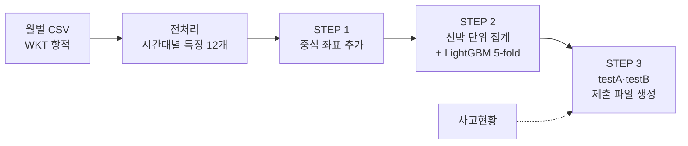

# 🚢 어선 항적 데이터 기반 조업방식 판별 및 이상항적 탐지

> 2026 DATA·AI 분석 경진대회 · 어선 사고예방 항적데이터 분석 (문제해결 부문)

>>>>>>> dd1fc80 (README 수정)

V-Pass 어선 위치 기록(GIS 항적)만으로 **① 어선의 조업방식을 분류**하고, **② 평소와 다른 움직임에서 사고 시각을 탐지**하는 프로젝트입니다.
조업방식마다 "정상적인 움직임"이 다르기 때문에, 과제 1의 분류 결과를 과제 2의 이상 판단 기준으로 연결하는 구조를 목표로 했습니다.

| 과제 | 내용 | 평가 지표 | 결과 |
|---|---|---|---|
| 과제 1 (Test A) | 선박별 조업형태 4종 분류 | micro-F1 | **리더보드 0.61** · 교차검증 0.60 (기준선 0.50) |
| 과제 2 (Test B) | 선박별 사고 발생 시각 예측 | 6시간 오차 허용 F1 | 규칙 기반 baseline |

---

## 1. 데이터

| 구분 | 내용 |
|---|---|
| 항적 | 2026년 1~6월, 월별 CSV 6개 (압축 해제 약 5.7GB) |
| 단위 | 한 행 = 선박 × 날짜 × 시간대(0~23시) 항적 |
| 컬럼 | `part_dt`, `rfid_id`, `rfid_time`, `geom`(MULTILINESTRING WKT), `fishing_code`(Train만) |
| 규모 | Train 약 389만 행 · 7,372척 / Test 약 421만 행 · 7,768척 |
| 클래스 | 연안복합 49.5%, 자망 34.2%, 통발 14.2%, 채낚기연승낚시 2.1% (선박 기준) |
| 보조 자료 | 해양경찰 사고현황 167건 (발생일시·위경도·어업면허·사고유형) |

> 대회 데이터는 외부 공개가 제한되어 저장소에 포함하지 않았습니다.

**데이터 점검 결과**: 파싱 실패·중복 0건, 선박별 라벨 불일치 0척. 선박당 기록 수는 1개부터 수천 개까지 편차가 커서, 선박 단위 집계 설계가 핵심 과제였습니다.

---

## 2. 파이프라인



| 단계 | 파일 | 역할 |
|---|---|---|
| 전처리 | (팀원 담당) | ZIP을 풀지 않고 스트리밍으로 읽어 WKT 파싱, 품질 플래그, 시간대별 항적 특징 계산 → 월별 parquet |
| STEP 1 | `step1.py` | 원본 geom에서 중심 경위도를 계산해 `source_row`로 결합 (전처리 재실행 없이 약 1분/월) |
| STEP 2 | `step_v4.py` | 선박 단위 집계 → 실험 구성 비교 → 최고 구성으로 Test A 예측 |
| STEP 3 | `step3.py` | 제출샘플 양식에 testA·testB를 채워 2시트 xlsx 생성 |

**메모리 설계**: 원본 전체를 한 번에 올리지 않고 월별로 처리한 뒤, 무거운 geom을 버린 특징 parquet만 합쳤습니다. parquet은 필요한 컬럼만 읽어 31개 중 17개만 메모리에 올립니다.

---

## 3. 특징 엔지니어링

### 3-1. 시간대별 항적 특징 (전처리)
WGS84 측지 거리로 계산한 미터 단위 특징입니다. 선 조각이 끊긴 지점은 이어 계산하지 않고, 정지 구간에서는 방향 변화를 계산하지 않았습니다.

`점 개수` `선 조각 수` `연속 정지 비율` `이동거리 합·평균·최대·편차` `이동 범위(동서·남북)` `꺾임 각도 평균·최대` `중심 경위도`

### 3-2. 선박 단위 집계 (STEP 2)
제출이 선박당 1행이므로, 수백~수천 개 시간대 기록을 한 줄로 요약했습니다. 같은 선박도 날마다 패턴이 크게 흔들려(선박 내 변동이 선박 간 차이의 0.4~0.7배) 평균만으로는 부족하다고 판단했습니다.

| 그룹 | 특징 |
|---|---|
| 항적 모양 | 각 특징의 평균·표준편차·중앙값·최대·최소, **움직일 때만의 중앙값** |
| 활동 시간 | 새벽·오전·오후·밤 활동 비율 (시각 평균 대신 비율로 순환성 문제 회피) |
| 활동량 | 기록 수, 활동 일수, 하루 기록 수, 정지 비율 |
| 위치 | 전체 중앙값·범위, **정지 위치(모항 추정)**, **이동 위치(어장 추정)**, 10/90% 분위 |
| 월별 패턴 | 1~6월 각 달의 활동 비율 (조업형태별 성어기 차이) |
| 이웃 선박 | **모항 근처 학습 선박 10·30척의 조업형태 비율**과 평균 거리 (KNN) |
| 항해 패턴 | 모항 2km 밖 연속 구간을 항해로 묶어 항해 수·길이·밤샘·24h 이상 장기 항해·최대 거리·바다 위 정지 비율 |

---

## 4. 검증 설계

테스트 선박은 학습에 없는 **신규 선박**이므로, 같은 선박이 학습·검증에 섞이지 않는 것을 최우선으로 설계했습니다.

- 6개월을 먼저 선박 단위로 집계한 뒤 **StratifiedKFold 5-fold** (선박 = 행)
- **KNN 특징 누수 방지**: fold의 학습 선박만 이웃 후보로 쓰고, 학습 선박 자신은 이웃에서 제외
- Test 예측 = fold별 모델 5개의 확률 평균
- 클래스별 확률 보정은 교차검증에서 0.003 이상 개선될 때만 적용
- 리더보드는 100척 채점이라 ±0.05 수준의 우연 오차가 있어, **의사결정은 교차검증(7,372척) 기준**으로 했습니다

---

## 5. 실험 결과 (과제 1)

### 개선 과정
| 단계 | 구성 | 교차검증 micro-F1 |
|---|---|---|
| 기준선 | 전부 최다 클래스로 예측 | 0.495 |
| v1 | 모양 + 시간대 + 위치 집계 | 0.583 |
| v2 | + 월별 활동 비율 + KNN 이웃 | **0.599** |
| v4 | + 항해 패턴 | 0.599 (리더보드 0.60 → **0.61**) |

### 1월 데이터 탐색에서 얻은 핵심 인사이트
| 특징 구성 | micro-F1 |
|---|---|
| 기준선 | 0.488 |
| 항적 모양 + 시간대만 | 0.499 |
| + 위치 | 0.552 |
| + 위치 세분화 | 0.561 |

**항적 모양만으로는 기준선 수준**이었고, 성능은 대부분 위치에서 나왔습니다. 연안복합·자망·통발은 1시간 단위 이동 모양이 거의 같았기 때문입니다. 이 발견으로 전처리 단계에 위치 컬럼을 추가하도록 방향을 바꿨습니다.

### 효과가 없어 제외한 시도
| 시도 | 결과 |
|---|---|
| class_weight 균형 보정 | micro-F1 하락 (다수 클래스 정확도 손실) |
| 어장 기준 KNN 확장 | 소폭 하락 |
| 방문 해역 격자 + 로지스틱 회귀 스태킹 | +0.2%p, 위치 정보가 이미 반영됨 |
| rfid 앞자리 | 앞자리별 클래스 분포 차이 없음 |
| Test 선박 pseudo labeling | 처음엔 +3%p로 보였으나 **검증 라벨 누수**였음. fold 안에서만 생성하자 효과 불안정 → 제외 |

### 남은 한계
주된 오답은 **자망·통발 → 연안복합**입니다 (재현율: 연안복합 0.85, 자망 0.43, 통발 0.14). 연안복합은 여러 어법을 함께 쓰는 면허라 항적만으로 구분하기 어려운 구조적 한계가 있습니다.

---

## 6. 과제 2: 이상항적 탐지

### 접근
1. **이상도 점수**: 선박별로 시간대 특징(이동거리, 최대 이동 간격, 꺾임, 선 조각 수, 정지 비율, 직전 대비 위치 점프, 기록 간격)이 **그 선박의 평소 값**(중앙값·MAD)에서 얼마나 벗어났는지 robust z-score로 계산해 0~1로 정규화
2. 선박별 최고 점수 시각을 사고시각으로, 사고 전 24시간 점수를 추적 시각별로 기록

### 시도와 발견
| 시도 | 결과 |
|---|---|
| 상위 10%만 사고로 표시 | 0점 |
| 해경 사고현황과 시공간 결합 (±3h, 5km) | 3척만 연결, 0점 |
| 마지막 기록 시각 | 소폭 상승 |
| **전체 표시 + 이상도 최고 시각** | **최고점** |
| 사고 다발 시간대 가중치 / 급정지 점수 | 변화 없음 또는 하락 |

- testB 선박은 별도 파일이 아니라 기존 Train·Test 항적 안에 있다는 것을 제출 실험으로 확인했습니다
- 사고현황 분석 결과 **기상 양호 96%, 원인은 정비불량·운항부주의 다수, 기관손상이 최다 유형**으로, 날씨보다는 "조업 중 갑작스러운 정지·표류" 패턴이 핵심이라는 가설을 세웠습니다
- 사고 선박의 항적은 사고 후에도 이어지는 경우가 많아(구조·예인 후 운항) "신호 단절 = 사고" 가설은 기각했습니다

---

## 7. 배운 점

- **데이터 탐색이 방향을 정한다**: 1월 한 달로 빠르게 끝까지 돌려본 실험이 "모양보다 위치"라는 핵심 결론을 줬고, 전처리 요구사항을 바꾸는 근거가 됐습니다
- **누수는 점수를 부풀린다**: KNN 자기 제외, fold 내부 pseudo label 생성 등 검증 설계를 바꾸자 그럴듯했던 개선이 사라지는 경험을 했습니다
- **평가 표본 크기를 의식해야 한다**: 100척 리더보드의 ±0.05 오차를 인지하고, 교차검증으로 판단해 리더보드 과적합을 피했습니다
- **협업 설계**: 원본 행 번호(`source_row`)와 품질 플래그를 남긴 전처리 덕분에, 전처리를 다시 돌리지 않고 위치 컬럼을 추가할 수 있었습니다

---

## 8. 실행 방법

```bash
# Python 3.12 가상환경
py -3.12 -m venv ship_pj
ship_pj\Scripts\activate
python -m pip install -r requirements.txt

python step1.py      # 중심 좌표 추가 → pre_output/
python step_v4.py    # 선박 집계 + 학습 + Test A 예측 → output/testA_submission.csv
python step3.py      # 제출샘플에 testA·testB 채우기 → output/submission_*.xlsx
```

각 스크립트 상단의 설정 블록에서 데이터 경로를 지정합니다.

**주요 라이브러리**: pandas · pyarrow · shapely · pyproj · scikit-learn · LightGBM · openpyxl
